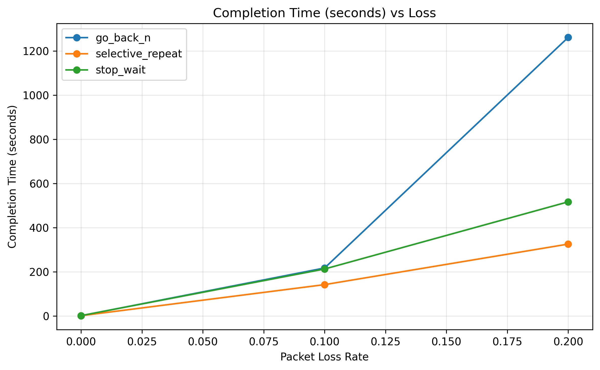
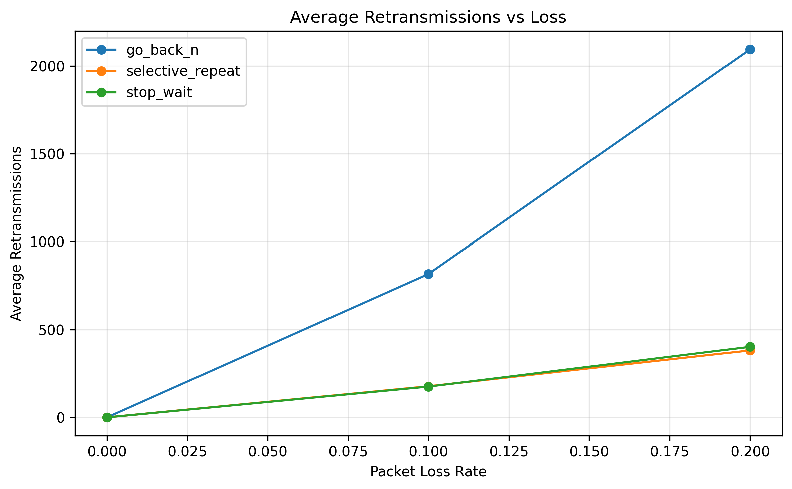
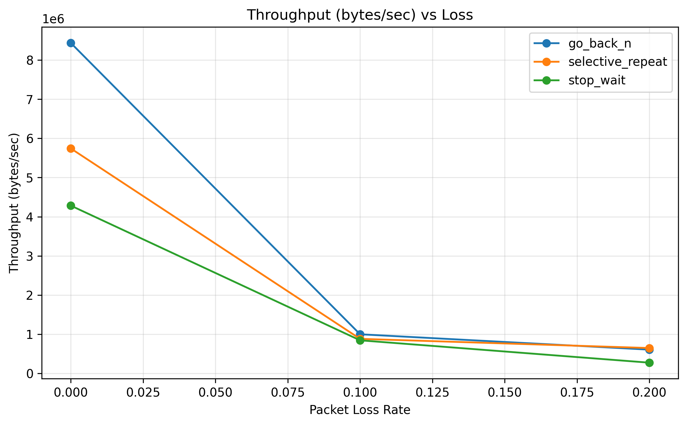

# Reliable Transport Protocol over UDP

Experimental implementation of a reliable transport layer over UDP with custom packet handling, CRC-based error detection, ARQ mechanisms, and network fault simulation.

## Project Overview

UDP provides fast communication but does not guarantee:

* Packet delivery
* Packet ordering
* Error detection
* Retransmission
* Flow control

This project builds a reliability layer on top of UDP.

Implemented features:

* Custom packet format
* Sequence numbers
* ACK handling
* CRC error detection
* Stop-and-Wait ARQ
* Network fault injection

  * Packet loss
  * Corruption
  * Delay
  * Duplication

Implemented reliability protocols:

* Stop-and-Wait ARQ
* Go-Back-N Sliding Window
* Selective Repeat Sliding Window

Current focus:

* Performance evaluation and comparison

---

# Setup

## Requirements

* Python 3.10+
* Git

Check installation:

```bash
python --version
git --version
```

---

# Clone Repository

```bash
git clone https://github.com/adharsh0713/reliable-udp.git

cd reliable-udp
```

---

# Virtual Environment (Recommended)

Create environment:

```bash
python -m venv venv
```

Activate:

### Windows PowerShell

```powershell
venv\Scripts\activate
```

### Linux/macOS

```bash
source venv/bin/activate
```

---

# Install Dependencies

Install required packages:

```bash
pip install -r requirements.txt
```

Current implementation mainly uses Python standard libraries.

---

# Project Structure

```
reliable-udp/

├── sender/
│   └── sender.py
│
├── receiver/
│   └── receiver.py
│
├── protocol/
│   ├── packet.py
│   ├── crc.py
│   └── timer.py
│
├── algorithms/
│   └── stop_wait.py
│
├── network/
│   ├── fault_injector.py
│   └── proxy.py
│
├── data/
│   ├── test_files/
│   └── results/
│
└── docs/
```

---

# Running the Project

The project uses Python modules, so commands should be executed from the project root.

Example:

```
reliable-udp/
```

---

## 1. Start Receiver

Open terminal 1:

```bash
python -m receiver.receiver
```

Receiver waits for incoming packets and reconstructs the transferred file.

---

## 2. Start Network Proxy

Open terminal 2:

```bash
python -m network.proxy
```

The proxy acts as the network layer between sender and receiver.

It can introduce:

* Packet loss
* Packet corruption
* Packet delay
* Packet duplication

---

## 3. Start Sender

Open terminal 3:

```bash
python -m sender.sender data/test_files/small.txt
```

The sender transfers the file through the proxy.

---

# Architecture

```
              File
                |
                v

             Sender

                |
                |
              UDP

                |
                v

        Fault Injection Proxy

     Loss  Corruption  Delay  Duplicate

                |
                v

            Receiver

                |
                v

        Reconstructed File
```

---

# Implemented Phases

## Phase 1 — UDP Foundation

Completed.

Implemented:

* UDP socket communication
* Sender and receiver model
* Basic file transfer

Flow:

```
Sender
   |
 UDP
   |
Receiver
```

---

# Phase 2 — Custom Packet Layer

Completed.

Implemented custom packet format.

Packet structure:

```
+----------------+
| Sequence ID    |
+----------------+
| Packet Type    |
+----------------+
| Payload Length |
+----------------+
| CRC            |
+----------------+
| Payload        |
+----------------+
```

Packet types:

```python
DATA = 0
ACK  = 1
END  = 2
```

Implemented:

* Packet serialization
* Packet deserialization
* Header handling

---

# Phase 3 — CRC Error Detection

Completed.

Implemented CRC32 checksum verification.

Flow:

```
Sender

Payload
   |
CRC generation
   |
Packet


Receiver

Packet
   |
CRC verification
   |
Accept / Reject
```

Testing:

Normal packet:

```
Packet accepted
```

Corrupted packet:

```
CRC mismatch
Packet discarded
```

---

# Phase 4 — Stop-and-Wait ARQ

Completed.

Implemented reliability using:

* ACK packets
* Timeout detection
* Retransmission
* Retry limit

Working flow:

```
Send DATA(seq)

        |
        v

    Wait ACK

        |
  +-----+------+
  |            |
ACK received  Timeout

  |             |
Next packet   Resend
```

Example:

Successful transfer:

```
Sending packet 0
ACK received: 0
Sending packet 1
ACK received: 1
```

Timeout example:

```
Sending packet 0
Timeout
Resending packet 0
```

---

# Phase 5 — Fault Injection Proxy

Completed.

Implemented network simulation layer.

Architecture:

```
Sender

  |
  v

Proxy

  |
  v

Receiver
```

---

# Phase 6 — Go-Back-N Sliding Window Protocol

Completed.

Implemented Go-Back-N reliability using:

\* Sliding window mechanism

\* Multiple packets in transmission

\* Cumulative ACK handling

\* Timeout based window retransmission

\* Sequence number tracking


Working flow:

\`\`\`

Window size = N


Send:

[0][1][2][3]


Receive ACKs


Move window forward

\`\`\`


Example:

\`\`\`

Sending packet 0

Sending packet 1

Sending packet 2

Sending packet 3


ACK received 0

ACK received 1

\`\`\`


Timeout handling:

\`\`\`

Timeout. Resending window


Sending packet 2

Sending packet 3

\`\`\`


Receiver behavior:

\* Accepts packets in order

\* Sends cumulative acknowledgements

\* Rejects out-of-order packets

\* Requests retransmission from missing packet onwards

---

# Phase 7 — Selective Repeat Sliding Window Protocol

Completed.

Implemented Selective Repeat reliability using:

\* Individual packet ACK handling

\* Receiver buffering

\* Individual packet timers

\* Selective packet retransmission


Working flow:

\`\`\`

Window:

[0][1][2][3]


Packet 1 lost


Receiver:

0 received

2 buffered

3 buffered


Only packet 1 retransmitted

\`\`\`


Sender behavior:

\* Maintains timer for each packet

\* Tracks acknowledged packets individually

\* Retransmits only expired packets


Receiver behavior:

\* Accepts packets within receiver window

\* Stores out-of-order packets

\* Sends ACK for every received packet

\* Delivers packets in correct order


Example:

\`\`\`

Sending packet 0

Sending packet 1

Sending packet 2

Sending packet 3


Timeout packet 1

Resending packet 1


ACK received 1

\`\`\`

---

## Supported Faults

### Packet Loss

Drops packets randomly.

Example:

```
FAULT: packet dropped
```

---

### Packet Corruption

Modifies packet data.

CRC detects corruption.

Example:

```
FAULT: packet corrupted

Receiver:
CRC mismatch
```

---

### Packet Delay

Adds artificial latency.

Example:

```
FAULT: delaying packet by 0.8s
```

---

### Packet Duplication

Sends duplicate packets.

Example:

```
FAULT: packet duplicated
Sending duplicate packet
```

Receiver handles duplicates by:

* Ignoring repeated data
* Sending ACK again

---

# Testing Completed

## Loss Test

Configuration:

```
Loss rate > 0
```

Observed:

```
Packet dropped

Timeout

Retransmission

ACK received
```

Result:

File transferred correctly.

---

## Corruption Test

Configuration:

```
Corruption enabled
```

Observed:

```
Corrupted packet received

CRC mismatch

Packet rejected
```

Result:

Incorrect data was not accepted.

---

## Delay Test

Configuration:

```
Artificial delay enabled
```

Observed:

```
Delayed packet

Timeout handling

Retransmission
```

Important:

Timeout must be greater than expected RTT.

Example:

```
DATA delay = 0.8s
ACK delay  = 0.8s

RTT ≈ 1.6s
```

---

## Duplication Test

Configuration:

```
Duplicate rate enabled
```

Observed:

```
Received DATA 0

Received DATA 0 again

Duplicate packet ignored
```

Result:

File contents remained correct.

---

# Checking Results

## Verify Received File

After transfer:

Check:

```
data/results/
```

Compare:

```
Original file

vs

Received file
```

Linux/macOS:

```bash
cmp original.txt received.txt
```

Windows:

```powershell
fc original.txt received.txt
```

No difference means the files match. The automated experiment runner additionally verifies SHA-256 hashes for each recorded transfer.

---

# Viewing Runtime Behaviour

The terminal logs show:

## Sender

Example:

```
Sending packet 0
Waiting for ACK
ACK received
```

---

## Proxy

Example:

```
Proxy received type=0 seq=0

FAULT: packet duplicated

Sending duplicate packet
```

---

## Receiver

Example:

```
Received DATA 0

Duplicate packet 0 ignored

ACK sent
```

## Experimental Evaluation

The reliability protocols were evaluated under different packet loss conditions.

### Experimental Setup

| Parameter | Value |
|---|---|
| Protocols | Stop-and-Wait, Go-Back-N, Selective Repeat |
| Packet Loss Rates | 0%, 20% |
| Runs per Configuration | 3 |
| Metrics | Completion Time, Throughput, Retransmissions |

Metrics are collected automatically. The definitions, benchmark matrix, and analysis limitations are documented in the sections below.

---

## Preliminary Results

### Completion Time vs Packet Loss

As packet loss increases, completion time increases because protocols require retransmissions.



---

### Retransmissions vs Packet Loss

Higher packet loss causes more retransmissions. Selective Repeat generally retransmits fewer unnecessary packets compared to Go-Back-N.



---

### Throughput vs Packet Loss

Throughput decreases as packet loss increases due to additional retransmission overhead.




---

# Phase 6 — Go-Back-N Sliding Window

Completed.

Implemented in:

```text
algorithms/go_back_n.py
```

Go-Back-N allows multiple packets to be outstanding before acknowledgements arrive. It uses a sender-side sliding window and cumulative acknowledgements. When recovery is required, the sender can retransmit the outstanding window beginning at the earliest unacknowledged packet.

Key concepts:

- Sender window and base sequence number
- Multiple in-flight DATA packets
- Cumulative ACK processing
- Timeout-based recovery
- Retransmission accounting
- Sequence and ACK validation

### Expected behavior

A larger window can improve link utilization by allowing the sender to transmit more packets without waiting for each individual ACK. Under packet loss, however, Go-Back-N may retransmit packets that were sent after the lost packet even if some of them had reached the receiver. This creates a trade-off between pipeline utilization and recovery overhead.

---

# Phase 7 — Selective Repeat Sliding Window

Completed.

Implemented in:

```text
algorithms/selective_repeat.py
```

Selective Repeat uses individual acknowledgements and allows valid out-of-order packets to be buffered at the receiver. Recovery can target the packets that need retransmission instead of retransmitting every outstanding packet after a gap.

Key concepts:

- Sliding sender window
- Individual ACK processing
- Receiver buffering for out-of-order packets
- Per-packet retransmission timing
- Selective retransmission
- Duplicate packet handling

### Expected behavior

Selective Repeat can reduce unnecessary retransmissions compared with Go-Back-N when packets are lost within a window. It requires more state and more involved sender/receiver logic. Its measured performance still depends on timeout behavior, loss patterns, file size, and window size.

---

# Phase 8 — Automated Experiment Runner

Implemented in:

```text
experiments/runner.py
experiments/launcher.py
experiments/results.py
experiments/metrics.py
```

The runner launches the receiver and proxy for each transfer, configures the chosen protocol and fault settings, invokes the sender, verifies the received file, and writes a result row to CSV.

## Benchmark matrix

The checked-in runner defines:

```python
PROTOCOLS = [
    "stop_wait",
    "go_back_n",
    "selective_repeat",
]

TEST_FILES = [
    "small.txt",
    "medium.txt",
    "large.txt",
    "image.jpg",
]

LOSS_VALUES = [0.0, 0.1, 0.2]
WINDOW_VALUES = [1, 4, 16]
RUNS = 3
```

Stop-and-Wait is run with window size 1. Go-Back-N and Selective Repeat use window sizes 1, 4, and 16.

This yields 252 transfer records when all configurations complete successfully:

- Stop-and-Wait: 4 files × 3 loss levels × 1 window × 3 runs = 36 transfers
- Go-Back-N: 4 files × 3 loss levels × 3 windows × 3 runs = 108 transfers
- Selective Repeat: 4 files × 3 loss levels × 3 windows × 3 runs = 108 transfers

Total: 252 transfers.

## Fault isolation in the benchmark

The automated runner changes data loss across 0%, 10%, and 20%. For this matrix, it explicitly sets the following fault parameters to zero:

- Data corruption
- Data delay
- Data duplication
- ACK loss
- ACK corruption
- ACK delay
- ACK duplication

The proxy supports additional faults, and the earlier manual tests described above exercise some of them. However, they are not independent variables in this particular automated benchmark.

## SHA-256 verification

After a transfer, the runner computes SHA-256 hashes for the original and received files. A result is recorded only after the source and received hashes match.

The CSV field:

```text
hash_verified
```

should be `True` for successful recorded transfers. CRC validates packet contents during transfer; SHA-256 comparison checks the reconstructed file end to end.

## Running the benchmark

**Warning:** The full matrix can take a long time, particularly for large files under high packet loss. Do not rerun the complete matrix merely to view existing results.

From the repository root, with dependencies installed:

```powershell
python -m experiments.runner
```

The runner reports failed configurations and exits with a non-zero status if any experiments fail. Review the final failure summary before treating a new run as complete.

---

# Phase 9 — Performance Analysis and Visualization

Implemented in:

```text
experiments/analysis.py
```

Run analysis against the existing CSV:

```powershell
python -m experiments.analysis
```

The analysis script reads:

```text
data/results/experiment_results.csv
```

If the `hash_verified` column is present, the analysis filters to rows whose value is `True`. It converts relevant columns to numeric values, removes incomplete records, and aggregates trials by:

- Protocol
- File name
- File size
- Window size
- Data loss rate

The aggregated CSV is written to:

```text
data/results/aggregated_results.csv
```

Generated plots are written to:

```text
data/results/graphs/
```

## Metrics

### Completion time

Completion time is calculated as:

```text
end time - start time
```

It represents the duration measured by the metrics timer for the transfer. Longer completion time indicates slower file delivery under the measured conditions.

### Effective throughput

Throughput is calculated as:

```text
file size in bytes / completion time in seconds
```

The unit is bytes per second. This is effective file-transfer throughput, not raw link capacity or total wire throughput.

### Retransmissions

The retransmission metric counts retransmission events recorded by the protocol implementation. It is a measure of recovery activity. Its interpretation depends on the implementation's event counting, so comparisons should use the same code version and matched experimental conditions.

### SHA-256 verification

The hash verification field indicates whether the source file and reconstructed file matched after the transfer. It is an integrity check, not a performance metric.

## Understanding the plots

The analysis produces three overview plots:

```text
throughput_vs_loss.png
completion_vs_loss.png
retransmissions_vs_loss.png
```

It also produces three dashboards:

```text
throughput_dashboard.png
completion_time_dashboard.png
retransmissions_dashboard.png
```

The dashboards separate files by row and protocols by column. Each line corresponds to a window size; error bars show the standard deviation across repeated trials.

The overview plots average over file sizes and window sizes, so they provide a broad summary but are not sufficient on their own for a fair protocol comparison. For interpretation, compare the same file, data-loss rate, and window size wherever the protocols support the same configuration.

## Interpreting protocol behavior

These are protocol-level expectations, not guarantees for every measured configuration:

- **Stop-and-Wait:** only one packet can be outstanding, so waiting for ACKs limits pipeline utilization. Loss recovery may add timeout delays.
- **Go-Back-N:** a sliding window can improve utilization, but a loss can trigger retransmission of multiple outstanding packets.
- **Selective Repeat:** individual ACKs and receiver buffering can reduce unnecessary retransmissions, at the cost of more state and timer handling.
- **Increasing data loss:** usually creates more recovery work and can increase completion time.
- **Increasing window size:** can improve throughput when the sender would otherwise be idle, but can also increase recovery overhead under loss.
- **Increasing file size:** increases the number of packets and therefore the number of opportunities for packet loss and recovery.

Do not conclude that one protocol is always fastest based on protocol design alone. Discuss what the actual data shows for each matched condition.

---

# Reproducibility and Result Files

The main experiment artifacts are:

```text
data/results/experiment_results.csv
data/results/aggregated_results.csv
data/results/graphs/
docs/graphs/
```

The `data/results/` directory is used for generated experiment outputs and can contain received files and runtime metrics. Published graphs intended for the README are stored separately in `docs/graphs/` so they can be committed without tracking all temporary run outputs.

The full matrix is designed to run three trials per configuration. When reporting a result, state the number of successful trials used for the calculation. If a run fails or has an unusually large completion time, report that transparently rather than silently discarding it.

## Published graphs

The following image paths are used by this README. Make sure the files exist in `docs/graphs/` before committing so that the images render on GitHub.

```text
docs/graphs/completion_time_dashboard.png
docs/graphs/retransmissions_dashboard.png
docs/graphs/throughput_dashboard.png
docs/graphs/completion_vs_loss.png
docs/graphs/retransmissions_vs_loss.png
docs/graphs/throughput_vs_loss.png
```

The dashboard graphs preserve the file and window dimensions. The three overview graphs average across conditions and should be interpreted more cautiously.

---

# Troubleshooting

## Module import errors

Run commands from the repository root. Use module syntax:

```powershell
python -m receiver.receiver
python -m network.proxy
python -m sender.sender data/test_files/small.txt
```

Do not run these module commands from inside the `sender`, `receiver`, or `network` directories.

## Port already in use

The receiver and proxy bind UDP ports. If a previous process is still running, stop it before starting a new instance. Check the terminal windows used to start the receiver and proxy and terminate those processes cleanly.

## Sender timeouts

A timeout can happen when a packet or ACK is dropped, the receiver or proxy is not running, the configured timeout is too short for the simulated delay, or a process exited unexpectedly. Check the receiver and proxy logs before assuming that the ARQ implementation is incorrect.

## Received file does not match

Do not rely only on file names or file sizes. Compare the source and received files, or compare their SHA-256 hashes. For automated runs, the experiment runner checks SHA-256 and raises an error if the hashes differ.

## Experiment run is taking a long time

Large files combined with loss and timeout-based recovery can make the matrix slow. Avoid starting another full matrix while one is running. If only graphs are needed, use:

```powershell
python -m experiments.analysis
```

This regenerates the plots from the existing CSV without retransferring the files.

---

# Current Project Status

The implementation and supplied experiment artifacts cover:

- UDP-based file transfer
- Custom packet serialization and validation
- CRC32 error detection
- Stop-and-Wait ARQ
- Go-Back-N ARQ
- Selective Repeat ARQ
- Configurable packet fault injection
- Transfer metrics and CSV result recording
- SHA-256 end-to-end integrity verification
- Automated experiment matrix
- Aggregation and performance graphs
- Unit tests for packet handling, metrics, and ARQ implementations

The experiment dataset should be described as a controlled, synthetic evaluation. The local proxy is useful for repeatable testing, but it does not reproduce every characteristic of a real network, such as congestion, bandwidth limits, correlated loss, or geographic latency.

# Limitations

- The automated matrix isolates data loss; corruption, delay, duplication, and ACK-side faults are disabled during those runs.
- The local environment does not represent a real wide-area network.
- Three trials per configuration provide a limited estimate of variability.
- Averages can be strongly affected by unusually long runs. Report such cases and use spread measures or medians where useful.
- The overview plots pool different files and windows, so detailed conclusions should rely on matched configurations.
- Performance depends on implementation details, timeout and retry settings, chunk size, runtime scheduling, and machine conditions.

# Future Work

- Investigate extreme completion times and timeout/retransmission behavior.
- Increase repetitions to improve estimates of variability.
- Add separate controlled benchmark matrices for corruption, delay, duplication, and ACK loss.
- Compare protocols at matched file sizes, loss rates, and window sizes.
- Evaluate under controlled bandwidth and latency constraints.
- Improve instrumentation to distinguish retransmitted packets from unique data packets delivered.
